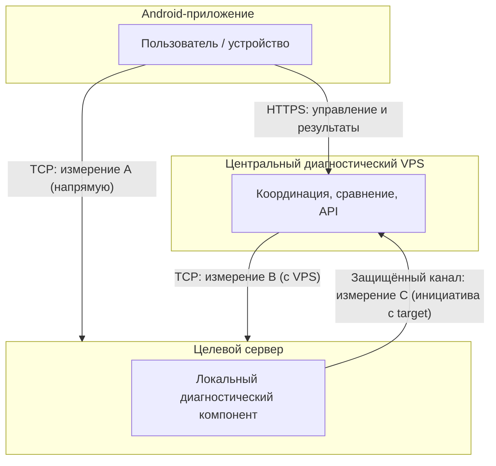

# Архитектура Port Scanner (утверждено владельцем проекта)

Документ фиксирует **архитектурные решения, явно утверждённые владельцем проекта**. Он описывает целевую систему. Текущая реализация в репозитории может отставать; расхождения перечислены в [разделе 15](#15-подтверждённые-расхождения-с-текущей-реализацией-и-документацией).

---

## 1. Назначение и область действия

Этот документ определяет:

- состав системы и границы ответственности компонентов;
- потоки диагностических данных и правила сопоставления измерений;
- требования к идентификации, политике портов, свежести данных и статусам;
- границы транспорта и доверия;
- условия допуска к эксплуатации.

**Вне области действия:** детальный формат API, конкретные протоколы аутентификации (если не зафиксированы в репозитории), алгоритмы итоговой классификации диагностики, пошаговые инструкции сборки и развёртывания.

---

## 2. Статус документа и правила его изменения

| Параметр | Значение |
|----------|----------|
| Статус | Живой документ; единственный источник **утверждённой архитектуры** |
| Язык | Русский |
| Изменения | Только по явному решению владельца проекта; нумерация решений `A-NNN` сохраняется, новые решения получают следующий свободный идентификатор |
| Связь с кодом | Изменение этого файла **не** означает автоматической реализации; внедрение — отдельные задачи разработки |

---

## 3. Иерархия технической документации

**A-001 (утверждено владельцем).** Порядок авторитетности:

1. **`ARCHITECTURE.md`** — утверждённая архитектура всей системы: компоненты, обязанности, взаимодействия, потоки данных, границы безопасности, архитектурные принципы.
2. **`prompts/00_overview.md`** — общий контракт API. Должен оставаться согласованным с утверждённой архитектурой.
3. **`prompts/01_server.md`** и **`prompts/02_android_client.md`** — спецификации реализации компонентов, подчинённые архитектуре и общему контракту API.
4. **`server/DEPLOY_LINUX.md`** и **`android/BUILD.md`** — эксплуатационные и сборочные инструкции.
5. **`README.md`** и **`ROADMAP.md`** — онбординг и планирование разработки; **не** являются самостоятельным источником архитектурных решений.

**Политика конфликтов (утверждено владельцем):**

- Утверждённая архитектура задаёт **целевой** дизайн системы.
- Спецификации и инструкции нижнего уровня должны **в конечном счёте** ему соответствовать.
- Разрешение противоречий в спецификациях и коде — **отдельные** задачи после ревью; в этом документе конфликты только **фиксируются**, без их скрытого «исправления» текстом.

---

## 4. Общая архитектура системы

**A-002 (утверждено владельцем).** Система состоит из **трёх** классов компонентов:

| Компонент | Роль |
|-----------|------|
| **Android-приложение** | Инициирует сеанс диагностики, выбирает порты, получает от центрального VPS итоговое заключение, выполняет **прямые** TCP-проверки к назначенному целевому серверу |
| **Центральный диагностический VPS** | Координация многих целевых серверов и многих зарегистрированных пользователей/устройств Android; внешняя диагностическая «точка обзора» (измерение B); приём локальных результатов с целевых серверов; сравнение измерений и выдача заключения приложению |
| **Целевые серверы (множество)** | Хостят **целевой** диагностический компонент; выполняют локальную диагностику (измерение C); **инициируют** передачу результатов на VPS |

Центральный VPS обслуживает **несколько** целевых серверов и **несколько** зарегистрированных установок Android.

---

## 5. Компоненты и границы ответственности

### Android-приложение

- Привязано к **зарегистрированному** пользователю/установке и **назначенному** целевому серверу (см. [раздел 7](#7-идентификация-пользователей-устройств-и-серверов)).
- Запрашивает у VPS диагностическое заключение по выбранным портам.
- Выполняет измерение **A** (см. [раздел 6](#6-потоки-диагностических-данных)) **самостоятельно**, без релея диагностического TCP через VPS или TURN.

### Центральный диагностический VPS

- Регистрация целевых серверов, пользователей, устройств и целевых диагностических компонентов.
- Приём и учёт локальных результатов с целевых серверов (измерение C).
- Независимое внешнее сканирование портов целевого сервера с сети VPS (измерение B).
- Сопоставление доступных измерений, оценка свежести данных, выдача заключения Android по **HTTPS API**.
- Принудительное применение **политики портов** для конкретного целевого сервера (см. [раздел 8](#8-выбор-портов-и-ограничения)).

### Целевой сервер (диагностический компонент)

- Локальная диагностика (измерение C) по расписанию и/или вручную — согласно **локальной конфигурации** компонента.
- **Инициация** передачи результатов на VPS по **защищённому** каналу.
- **Индивидуальная идентификация** компонента на VPS.
- **Не** требуется входящее административное подключение с VPS к целевому серверу (см. [A-005](#9-локальная-диагностика-и-передача-результатов)).

**Факт о текущем репозитории (проверено по `origin/main`):** в дереве исходников представлены прототип **одного** Python HTTP-сервера (`server/server.py`) и Android-клиент; **отдельного** кода центрального VPS и целевого диагностического агента **нет**.

---

## 6. Потоки диагностических данных

**A-003 (утверждено владельцем).** В одном диагностическом сеансе допускаются **три независимых** набора измерений:

| Источник | Код | Кто выполняет | Что измеряется |
|--------|-----|---------------|----------------|
| **Android → целевой сервер** | A | Android, прямой TCP с устройства | Доступность выбранных TCP-портов **по пути мобильной сети** до целевого сервера |
| **VPS → целевой сервер** | B | Центральный VPS, прямой TCP со своей сети | Те же порты с **внешней** точки обзора VPS |
| **Локально на целевом сервере** | C | Компонент на target, результат на VPS | Внутренняя диагностика на стороне target; доставка на VPS **инициируется target** |

**A-004 (утверждено владельцем).** Диагностический TCP-трафик измерения **A** **не** должен ретранслироваться через VPS или TURN (иначе измеряется другой сетевой путь).

VPS сравнивает **доступные** измерения и возвращает Android **диагностическое заключение** (детальный алгоритм классификации в этот документ **не** входит).

Типовая последовательность (логическая, не prescriptive API):

1. Android запрашивает диагностику выбранных портов у VPS (HTTPS).
2. Параллельно или по правилам реализации: Android выполняет A; VPS выполняет B; VPS учитывает последние данные C, полученные от target.
3. VPS отвечает Android заключением с явной квалификацией времени и свежести источников.

---

## 7. Идентификация пользователей, устройств и серверов

**A-006 (утверждено владельцем).** Система поддерживает **многих** зарегистрированных пользователей и устройств Android.

Идентичность и авторизация должны различать (как минимум):

- пользователя Android;
- устройство / установку приложения;
- **назначенный** целевой сервер;
- целевой диагностический компонент на сервере.

**A-007 (утверждено владельцем).** Пользователь Android **не** может произвольно регистрироваться или переключаться на **незарегистрированные** целевые серверы. Привязка «пользователь/устройство → целевой сервер» задаётся при подготовке инфраструктуры (см. [раздел 14](#14-условия-допуска-к-эксплуатации)).

**Детали формата учётных данных и протокола аутентификации** в утверждённой архитектуре **не** фиксируются, если они не установлены явно в репозитории. Текущий репозиторий описывает **демонстрационную** схему мастер-секрета и временного Bearer-токена в `prompts/00_overview.md` и `README.md` — это **реализационное** решение прототипа, а не полная модель мультипользовательской регистрации на VPS.

---

## 8. Выбор портов и ограничения

**A-008 (утверждено владельцем).**

- Пользователь Android **выбирает** порты для диагностики.
- Допустимый диапазон выбора пользователем: **произвольные TCP-порты 1–65535**.
- Администратор может задать **ограничения** разрешённых портов для **конкретного** целевого сервера.
- VPS **обязан** применять политику портов, привязанную к целевому серверу.

**Факт о текущем репозитории:** в `server/server.py` и спецификациях `prompts/*` действует жёсткий лимит `MAX_PORTS = 30` и валидация 1..65535 на стороне прототип-сервера; **политика портов per-target на VPS в коде отсутствует**.

---

## 9. Локальная диагностика и передача результатов

**A-005 (утверждено владельцем).**

- Целевой сервер **инициирует периодическую** доставку результатов на центральный VPS.
- Расписание и возможность **ручного** запуска локальной диагностики определяются **конфигурацией** программы на стороне target.
- Передача данных — по **защищённому** каналу связи.
- **Не** предполагается, что VPS устанавливает **входящее** соединение к целевому серверу.
- **Не** вводится обязательный входящий административный порт или удалённая оболочка на target.
- Компонент на target **индивидуально идентифицируется** на VPS.

Конкретная реализация target→VPS (опрос, постоянное соединение, WebSocket и т.п.) **не** утверждена владельцем в этом документе, если нет явной фиксации в репозитории (см. [раздел 16](#16-открытые-технические-вопросы)).

---

## 10. Внешняя диагностика VPS

**A-003 (утверждено владельцем), измерение B.** VPS самостоятельно проверяет те же выбранные порты целевого сервера **из своей сети**, выступая координирующим сервисом и внешней диагностической точкой.

**Факт о текущем репозитории:** `server/server.py` выполняет TCP-проверки только к **`127.0.0.1`** на машине, где запущен процесс (`SCAN_HOST = "127.0.0.1"`). Это соответствует **локальному** измерению на одном хосте, а не модели «VPS снаружи → удалённый target».

---

## 11. Свежесть данных и временные метки

**A-009 (утверждено владельцем).** Каждое диагностическое измерение должно нести достаточные метаданные:

- идентичность целевого сервера;
- проверяемые порты;
- время **начала** и **завершения** измерения;
- результаты по каждому порту/измерению;
- **версия** целевого диагностического компонента (для данных C);
- время **последней успешной** доставки локальных результатов с target.

VPS обязан отличать **свежие** результаты от **устаревших**. Результаты с **разных** моментов времени **не** должны представляться как одновременные измерения **без явной квалификации**.

**Факт о текущем репозитории:** ответ `POST /scan` прототипа (`prompts/00_overview.md`, `server/server.py`) содержит только карту `"OPEN"|"CLOSED"` по портам **без** временных меток и без учёта свежести локальной доставки.

---

## 12. Статусы результатов и правила сопоставления

**A-010 (утверждено владельцем).** Допустимые **состояния измерения** (целевая модель):

| Статус | Смысл |
|--------|--------|
| `OPEN` | Порт доступен с точки зрения данного источника измерения |
| `CLOSED` | Порт подтверждён закрытым с точки зрения данного источника измерения |
| `LOCAL_DATA_UNAVAILABLE` | Локальные диагностические данные (C) отсутствуют |
| `LOCAL_DATA_STALE` | Локальные данные устарели |
| `LOCAL_CHECK_FAILED` | Локальная диагностика на target завершилась сбойно |

**A-011 (утверждено владельцем).** Отсутствие локальных данных — **условие отказа**. Его **нельзя** молча трактовать как `CLOSED`.

Итоговый статус сеанса может быть **`DEGRADED`** или **`FAILED`**, если локальные данные отсутствуют или непригодны. **Алгоритм** итоговой классификации в этот документ **не** входит.

**A-012 (утверждено владельцем).** Система **не** должна утверждать конкретную первопричину (например, «файрвол» или «NAT»), если имеющиеся измерения **не доказывают** это.

**Факт о текущем репозитории:**

- Контракт API и сервер возвращают только `"OPEN"` и `"CLOSED"` (`prompts/00_overview.md`, `server/server.py`).
- В `android/.../PortComparison.kt` при расхождении сервер/клиент формируется текст **«Заблокирован файрволом/NAT!»** — это **противоречит** A-012 относительно целевой архитектуры (в прототипе поведение уже реализовано).

---

## 13. Безопасность и границы доверия

**A-013 (утверждено владельцем).** Границы транспорта:

| Участок | Принцип |
|---------|---------|
| Android ↔ VPS (управление, заключения) | **HTTPS API** |
| Android → target (измерение A) | **Прямые TCP-соединения** |
| Target → VPS (результаты C) | **Инициатива с target**, защищённый канал |
| VPS → target (измерение B) | **Прямые внешние** проверки с VPS |
| TURN | **Не** является обязательным компонентом архитектуры |
| TURN и измерение A | TURN **не** должен ретранслировать диагностический TCP Android→target |

Границы доверия:

- VPS доверяет только **зарегистрированным** идентичностям target-компонентов и привязанным Android-установкам.
- Секреты и учётные данные выдаются **после** подготовки инфраструктуры (см. [раздел 14](#14-условия-допуска-к-эксплуатации)).

**Факт о текущем репозитории:** Android-клиент использует HTTPS к пользовательскому хосту (`README.md`, `android/BUILD.md`, `NetworkClient.kt`); прототип-сервер — plain HTTP (`server/server.py`). Это согласуется с моделью «TLS-терминатор + loopback backend» из `server/DEPLOY_LINUX.md`, но **не** отражает полноценный центральный VPS API из разделов 4–6.

---

## 14. Условия допуска к эксплуатации

**A-014 (утверждено владельцем).** Выдача учётных данных Android для целевого сервера означает, что подготовка инфраструктуры **уже выполнена**.

**Администратор целевого сервера:**

- устанавливает и настраивает целевой диагностический компонент;
- проверяет локальную диагностику;
- проверяет доставку результатов на центральный VPS.

**Администратор диагностического VPS:**

- регистрирует целевой сервер;
- настраивает идентичность и авторизацию;
- готовит приём и обработку результатов;
- проверяет готовность диагностического сервиса.

Только **после** готовности обеих сторон пользователям Android выдаются **индивидуальные** учётные данные.

---

## 15. Подтверждённые расхождения с текущей реализацией и документацией

Ниже — проверенные на `origin/main` противоречия между **утверждённой архитектурой** и **текущими** артефактами. Исправление — отдельные задачи; спецификации в этом PR **не** переписывались.

| # | Утверждённая архитектура | Текущее состояние (файлы) |
|---|--------------------------|---------------------------|
| R-01 | Три компонента: Android, центральный VPS, множество targets с агентом | Репозиторий: Android + один Python `server/server.py`; нет VPS-сервиса и target-агента |
| R-02 | Три источника A, B, C; VPS сравнивает и выдаёт заключение | `README.md`, `prompts/00_overview.md`: параллельно запрос к серверу и клиентское сканирование; сравнение в уведомлении на устройстве |
| R-03 | Пользователь не переключается на произвольный незарегистрированный target | Android UI: свободный ввод хоста (`activity_main.xml`, `prompts/02_android_client.md`) |
| R-04 | Измерение B с сети VPS к внешнему target | `server/server.py`: сканирование только `127.0.0.1` на localhost |
| R-05 | Измерение C: target инициирует доставку на VPS | Отсутствует код/спека target-компонента |
| R-06 | Статусы `LOCAL_*`, `DEGRADED`, `FAILED`; не трактовать отсутствие C как `CLOSED` | API: только `OPEN`/`CLOSED` (`prompts/00_overview.md`, `server/server.py`) |
| R-07 | Не утверждать NAT/файрвол без доказательств | `PortComparison.kt`: сообщение «Заблокирован файрволом/NAT!» |
| R-08 | Порты 1–65535 с политикой per-target на VPS | `MAX_PORTS = 30` (`server/server.py`, `prompts/01_server.md`) |
| R-09 | Метаданные времени, свежести, версии компонента | Ответ `/scan` без временных полей |
| R-10 | Android↔VPS: HTTPS API центрального сервиса | `prompts/00_overview.md`: `POST http://<IP>:8080/scan`; `README.md`/`android/BUILD.md`: HTTPS к произвольному хосту (прототип) |
| R-11 | Поля UI согласно целевой модели (назначенный target, без произвольной регистрации) | `prompts/02_android_client.md`: 3 поля ввода; в layout — 4 (добавлен HTTPS-порт), без модели регистрации на VPS |
| R-12 | Мультипользовательская регистрация на VPS | Демо `SECRET_TOKEN` / Bearer по окнам (`prompts/00_overview.md`) — единый секрет, не модель VPS |

---

## 16. Открытые технические вопросы

Вопросы, **намеренно не закрытые** этим документом (требуют отдельных решений владельца / спецификаций):

1. Конкретный протокол и формат **target → VPS** (push, long poll, WebSocket, очередь и т.д.).
2. Формат **HTTPS API** VPS (эндпоинты, тела запросов, коды `DEGRADED`/`FAILED`).
3. Алгоритм сопоставления A/B/C и пороги **устаревания** локальных данных.
4. Модель учётных записей: выдача, отзыв, привязка устройства к target.
5. Хранение и ретенция диагностической истории на VPS.
6. Нужен ли TURN для **не диагностического** трафика (архитектура допускает отсутствие TURN как обязательного компонента).

---

## 17. История изменений

| Дата | Версия | Изменение |
|------|--------|-----------|
| 2026-11-09 | 1.0 | Первоначальная фиксация утверждённой владельцем архитектуры; идентификаторы решений A-001…A-014 |

### Реестр архитектурных решений (краткий указатель)

| ID | Краткое содержание |
|----|-------------------|
| A-001 | Иерархия документации и политика конфликтов |
| A-002 | Топология: Android, центральный VPS, целевые серверы |
| A-003 | Три независимых источника измерений A, B, C |
| A-004 | Запрет релея диагностического TCP Android→target через VPS/TURN |
| A-005 | Локальная диагностика: инициатива target, защищённый канал, без inbound с VPS |
| A-006 | Раздельная идентичность пользователя, устройства, target, компонента |
| A-007 | Запрет произвольной регистрации / переключения на незарегистрированные targets |
| A-008 | Выбор портов пользователем 1–65535; политика портов per-target на VPS |
| A-009 | Метаданные измерений и различение свежих/устаревших данных |
| A-010 | Статусы `OPEN`, `CLOSED`, `LOCAL_*` |
| A-011 | Отсутствие локальных данных не равно `CLOSED`; `DEGRADED`/`FAILED` |
| A-012 | Запрет необоснованных утверждений о причине (NAT/файрвол) |
| A-013 | Границы транспорта (HTTPS, прямой TCP, TURN не обязателен) |
| A-014 | Условия готовности перед выдачей учётных данных Android |
